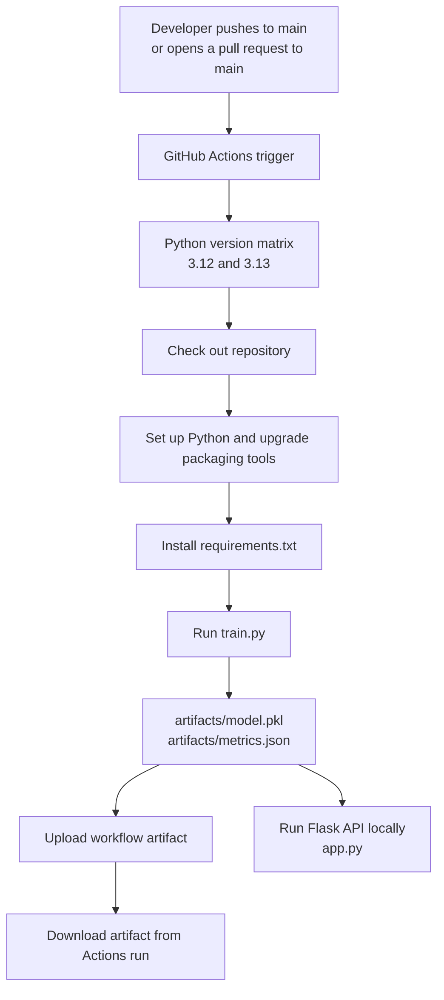

# MLOps: Iris model with GitHub Actions

This repository trains a scikit-learn classifier on the Iris dataset and demonstrates a GitHub Actions CI workflow. The workflow checks that training runs on multiple Python versions and saves the trained model and its evaluation metric as downloadable workflow artifacts.

> **CI versus CD:** The current GitHub Actions workflow implements continuous integration (CI): it installs dependencies, trains the model, and publishes build artifacts. It does not deploy the Flask application or model to a hosting environment, so deployment (CD) is not configured yet.

## Project architecture



GitHub-hosted Ubuntu runners execute the workflow. The matrix creates a separate job for each configured Python version, so each job gets a clean environment and independently installs dependencies, trains the model, and uploads its outputs. The training script uses scikit-learn's built-in Iris dataset, splits the examples into training and test sets, fits a logistic regression classifier, then writes the model and test accuracy under `artifacts/`.

The Flask app in `app.py` loads `artifacts/model.pkl` and serves `/health` and `/predict`. If the model file is missing when the app starts, it runs the training script first. The CI workflow does not start the web server; to run the API, train or download the model and start the app yourself.

## Requirements

- Python **3.12 or 3.13** (these are the versions tested by the GitHub Actions matrix)
- `pip`
- Git, if you are cloning the repository

Python packages are listed in [`requirements.txt`](requirements.txt):

- Flask — serves the prediction API.
- scikit-learn — provides the Iris dataset, train/test split, and logistic regression model.
- joblib — saves and loads the trained model.
- pandas — included as a project dependency.

## Install and run locally

1. **Clone the repository and enter its directory:**

   ```bash
   git clone https://github.com/saudhikmat/MLopsGithubActionIrisDataSet.git
   cd MLopsGithubActionIrisDataSet
   ```

2. **Create and activate a virtual environment.**

   macOS/Linux:

   ```bash
   python3 -m venv .venv
   source .venv/bin/activate
   ```

   Windows PowerShell:

   ```powershell
   py -3.12 -m venv .venv
   .venv\Scripts\Activate.ps1
   ```

   If you have multiple Python versions installed, choose Python 3.12 or 3.13 when creating the environment.

3. **Install the project dependencies:**

   ```bash
   python -m pip install --upgrade pip setuptools wheel
   python -m pip install -r requirements.txt
   ```

4. **Train the model and produce artifacts:**

   ```bash
   python train.py
   ```

   The command creates `artifacts/model.pkl` and `artifacts/metrics.json` and prints the test accuracy. Training is reproducible with the current fixed random seed and train/test split.

5. **Start the prediction API:**

   ```bash
   python app.py
   ```

   The Flask development server listens at `http://127.0.0.1:5001`.

6. **Check the health endpoint and request a prediction** (in a second terminal):

   ```bash
   curl http://127.0.0.1:5001/health
   curl -X POST http://127.0.0.1:5001/predict \
     -H "Content-Type: application/json" \
     -d '{"features":[5.1,3.5,1.4,0.2]}'
   ```

   The prediction request expects four numeric features in Iris order: sepal length, sepal width, petal length, and petal width. The returned prediction is the class index (`0`, `1`, or `2`).

## GitHub Actions CI: step-by-step

The workflow is [`ci.yml`](.github/workflows/ci.yml). It is stored under `.github/workflows/`, which is where GitHub discovers repository workflows.

1. **Workflow name — `name`:** `CI - Train and Save the model` is the display name shown in the Actions tab.
2. **When it runs — `on`:**
   - `workflow_dispatch` allows a user to start a run manually from the Actions tab.
   - `push` runs when commits are pushed to `main`.
   - `pull_request` runs for pull requests targeting `main`.
3. **Job and runner — `jobs.matrix-pip`:** Defines one job named “Train and Save the model” on `ubuntu-latest`, a GitHub-hosted Ubuntu machine.
4. **Python matrix — `strategy.matrix.python`:** Runs the same job twice, once with Python 3.12 and once with Python 3.13. Each run is isolated from the other.
5. **Checkout — `actions/checkout@v4`:** Checks out the repository contents on the runner so later steps can access the source and dependency file.
6. **Set up Python — `actions/setup-python@v4`:** Installs/selects the Python version for that matrix run using `${{ matrix.python }}`.
7. **Upgrade packaging tools:** `python -m pip install --upgrade pip setuptools wheel` updates the tools used to install Python packages.
8. **Install dependencies:** `python -m pip install -r requirements.txt` installs the packages declared by this repository.
9. **Train and inspect outputs:** `python train.py` fits the model and writes `artifacts/model.pkl` and `artifacts/metrics.json`. `ls -la artifacts` lists the generated files in the job log.
10. **Upload artifacts — `actions/upload-artifact@v4`:** Uploads the `artifacts` directory so it can be downloaded from the completed workflow run. Each matrix run gets its own artifact name, including the Python version and GitHub run ID.

### Important YAML expressions and structure

- `name` labels the workflow or an individual job/step for display in GitHub.
- `on` declares events that start the workflow; the branch filters restrict push and pull-request runs to `main`.
- `jobs` contains the work GitHub Actions executes. A job runs on its specified runner.
- `strategy.matrix` repeats a job for each value in a configuration list.
- `steps` run in order within each job. A step can use a published action (`uses`) or execute shell commands (`run`).
- `with` passes inputs to an action, such as the Python version or artifact path/name.
- `${{ matrix.python }}` and `${{ github.run_id }}` are GitHub Actions expressions. The first resolves to the current matrix version; the second identifies the workflow run.

### View or download CI artifacts

1. Open the repository on GitHub and select **Actions**.
2. Select a completed **CI - Train and Save the model** run.
3. Find the artifacts section on the run summary. The Python 3.12 and 3.13 jobs upload separately named artifacts.
4. Download the artifact for the version you need. It contains the model and metrics generated by that run.

## Adding deployment (CD)

There is no deployment target or deployment job in the current workflow. To complete a CI/CD pipeline, configure a hosting platform for the Flask API or model, then add a deployment job that runs after successful CI checks. Store deployment credentials as GitHub Actions secrets, limit deployment to an appropriate event/branch (commonly a protected release or `main` branch), and deploy the artifact or build a container image. The exact steps depend on the chosen hosting provider; no provider credentials are needed for the current CI workflow.

## Repository files

- [`train.py`](train.py) — loads Iris data, trains the classifier, and writes model and metrics artifacts.
- [`app.py`](app.py) — Flask health-check and prediction endpoints.
- [`requirements.txt`](requirements.txt) — Python package dependencies.
- [`.github/workflows/ci.yml`](.github/workflows/ci.yml) — GitHub Actions CI workflow.
- `artifacts/` — generated model and metrics output; it is also uploaded by CI.
